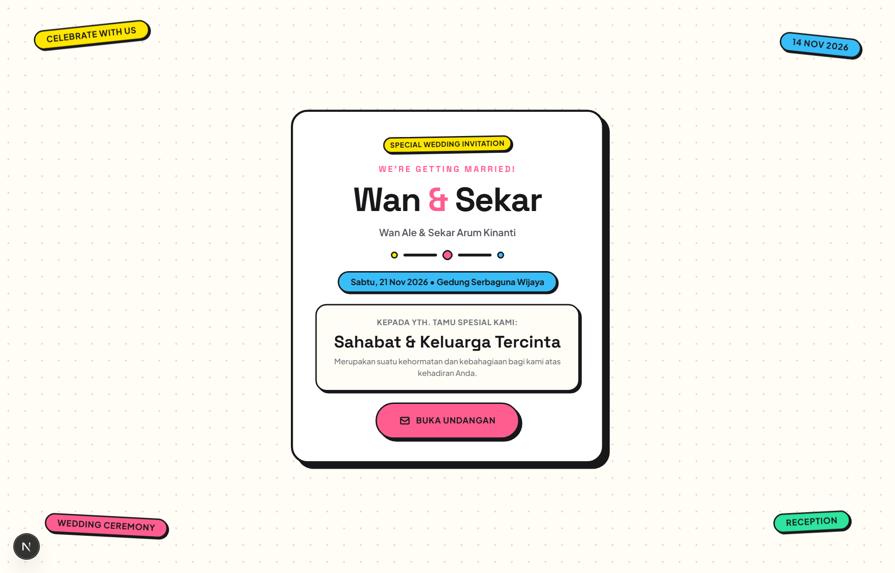
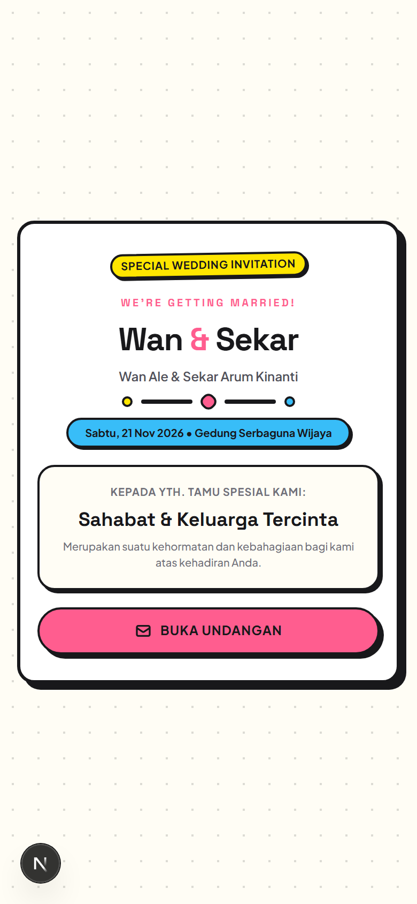
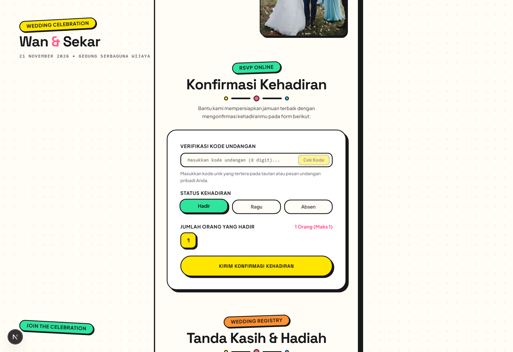
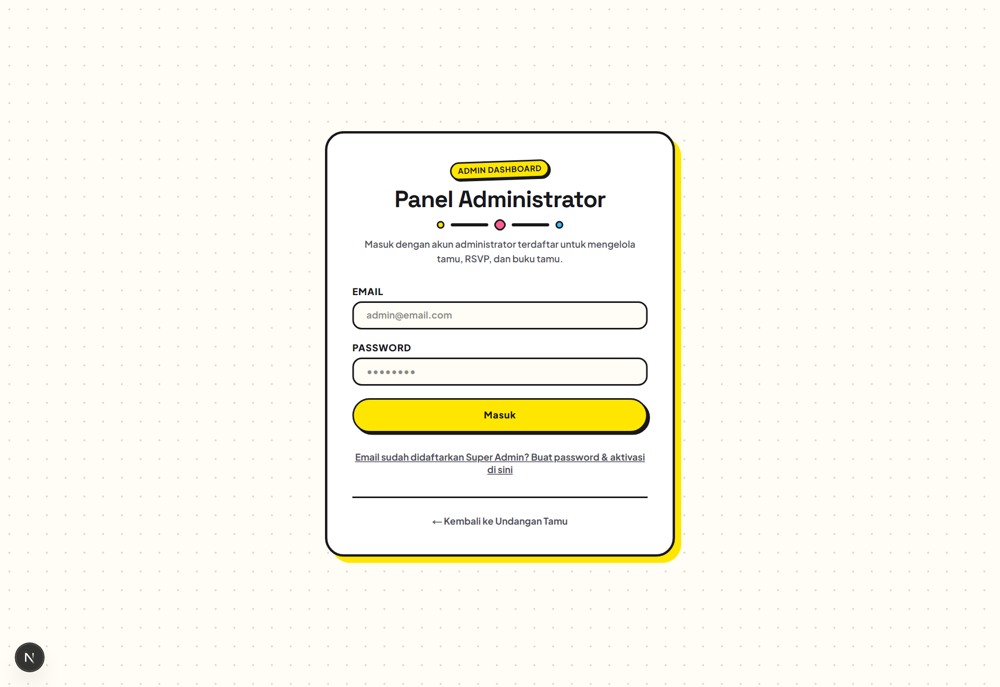
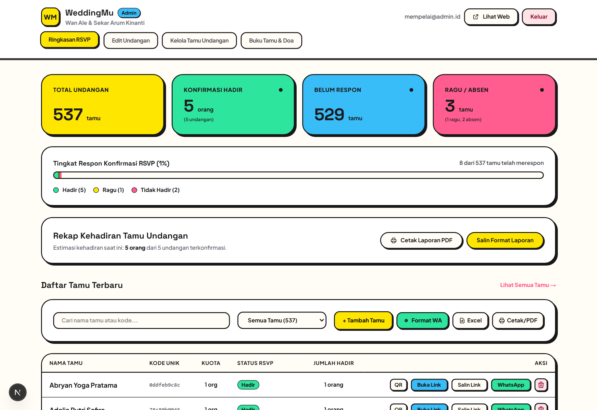
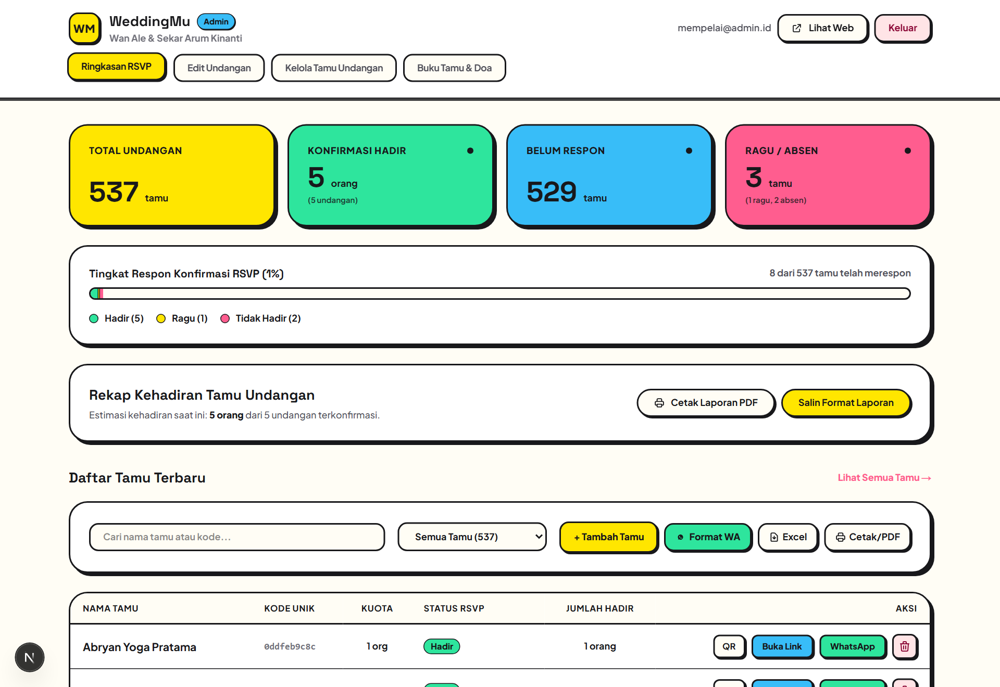
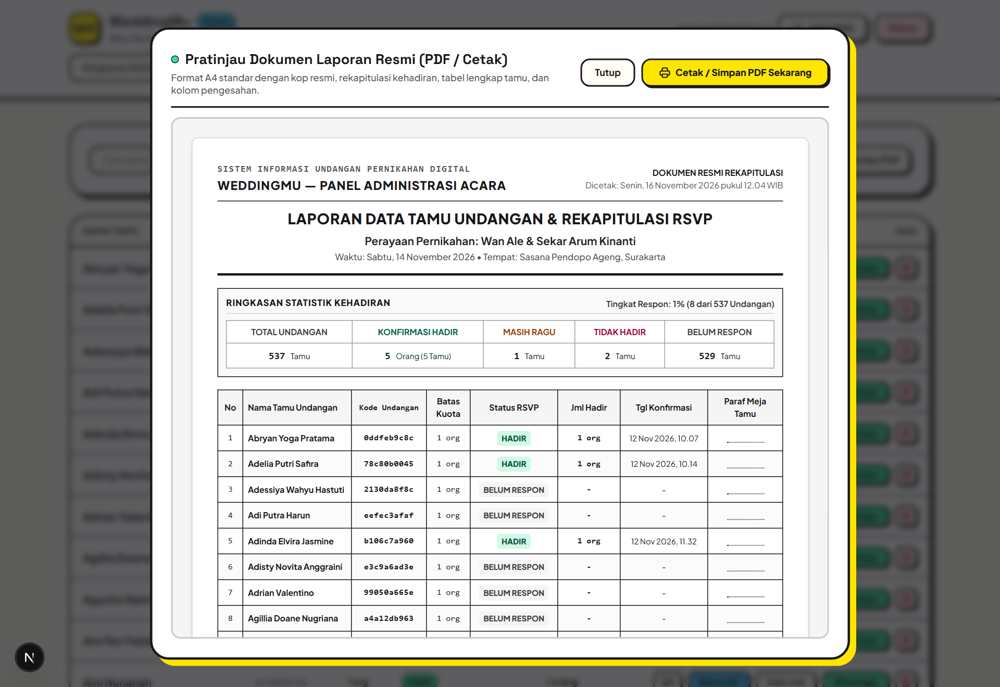
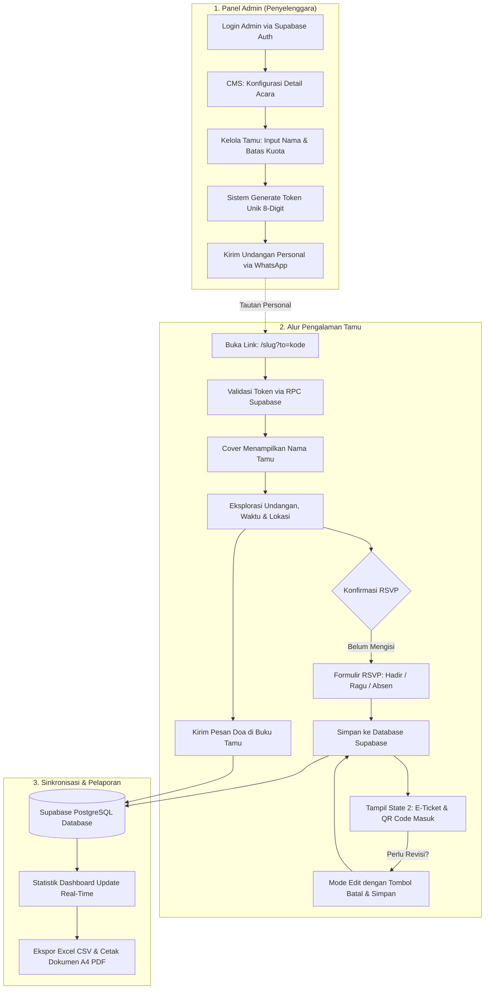
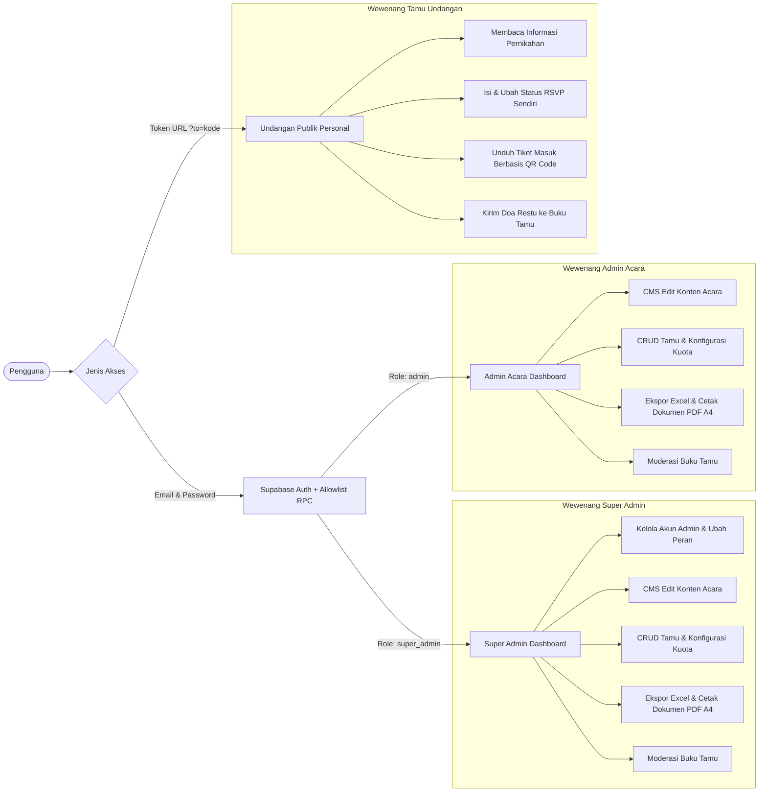
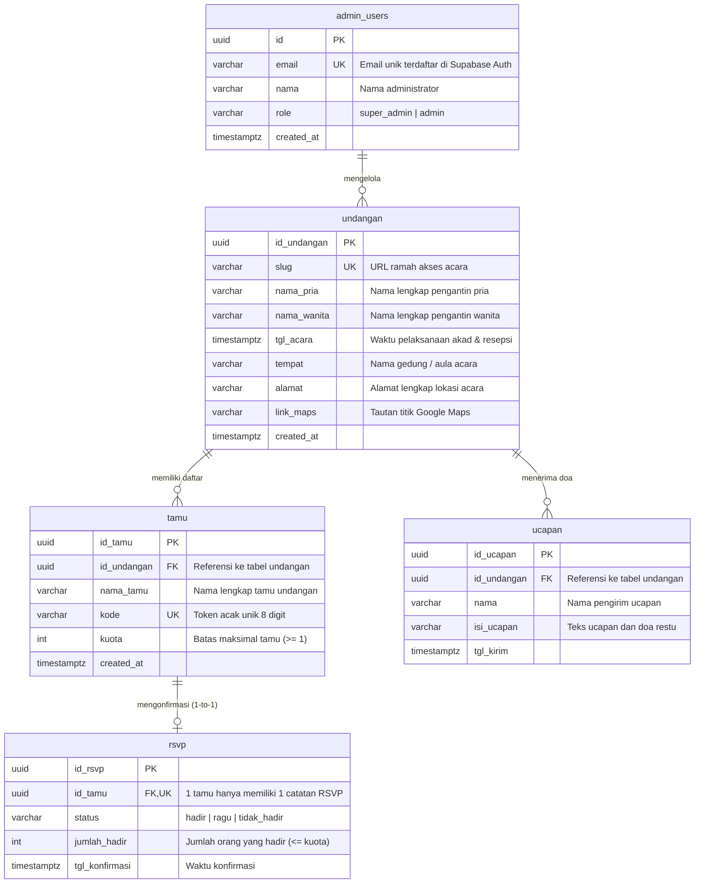

# WeddingMu — Digital Wedding Invitation Platform

<div align="center">


Platform Undangan Pernikahan Digital Interaktif dengan Sistem Konfirmasi Kehadiran (RSVP) Real-Time 2-State, E-Ticket Masuk Berbasis QR Code, Buku Tamu Digital, Manajemen Tamu Multi-Role (RBAC), Laporan Resmi Cetak PDF Format A4, dan Generator Tautan WhatsApp Otomatis.

*Dokumentasi Proyek Uji Kompetensi Keahlian (UKK) Rekayasa Perangkat Lunak.*

[Peran Pengguna](#peran-pengguna-dan-hak-akses) • [Tangkapan Layar](#tangkapan-layar) • [Fitur Utama](#fitur-utama-dan-keunggulan) • [Alur Sistem](#alur-sistem-dan-arsitektur) • [Struktur ERD](#entity-relationship-diagram-erd) • [Panduan Instalasi](#panduan-instalasi-dan-penggunaan)

</div>

---

## Daftar Isi
1. [Deskripsi Proyek](#deskripsi-proyek)
2. [Tangkapan Layar Sistem](#tangkapan-layar)
3. [Fitur Utama dan Keunggulan](#fitur-utama-dan-keunggulan)
4. [Alur Kerja dan Arsitektur Sistem](#alur-sistem-dan-arsitektur)
5. [Entity Relationship Diagram (ERD)](#entity-relationship-diagram-erd)
6. [Struktur dan Kamus Data](#struktur-dan-kamus-data)
7. [Peran Pengguna dan Hak Akses](#peran-pengguna-dan-hak-akses)
8. [Panduan Instalasi dan Penggunaan](#panduan-instalasi-dan-penggunaan)
9. [Keamanan Sistem](#keamanan-sistem)
10. [Pemenuhan Ketentuan Rubrik UKK](#pemenuhan-ketentuan-rubrik-ukk)
11. [Tech Stack](#tech-stack)
12. [Lisensi](#lisensi)

---

## Deskripsi Proyek

**WeddingMu** adalah aplikasi web modern yang mentransformasikan undangan pernikahan fisik konvensional menjadi media digital yang personal, interaktif, dan efisien. Dibangun untuk menyederhanakan manajemen pernikahan mulai dari penyebaran undangan personal, konfirmasi kehadiran tamu secara terukur, hingga pengarsipan ucapan doa restu dan pelaporan administratif.

### Masalah yang Diselesaikan:
- **Biaya & Waktu Cetak:** Pengadaan undangan cetak memerlukan biaya produksi tinggi, waktu pencetakan lama, serta distribusi fisik yang lambat.
- **Ketidakpastian Jumlah Kehadiran:** Tuan rumah kesulitan memperkirakan jumlah kehadiran aktual tamu untuk memesan porsi katering dan mengatur kapasitas ruang resepsi.
- **Buku Tamu Manual yang Rawan Hilang:** Buku tamu fisik di meja resepsi rawan rusak atau hilang, serta menyulitkan proses rekapitulasi data tamu yang hadir.
- **Pesan Undangan Tidak Personal:** Tautan undangan daring sering kali disebar secara massal tanpa menyapa nama tamu secara personal.

### Solusi yang Diterapkan:
- **Tautan Personal Dinamis (`?to=kode`):** Menampilkan nama tamu terundang secara otomatis di cover pembuka dan bagian RSVP undangan.
- **Sistem RSVP 2-State & Proteksi Pembatalan:** Menampilkan tiket konfirmasi resmi dan QR Code setelah tamu mengisi formulir, dengan mode edit terlindungi tombol "Batal Ubah" agar data tidak tertimpa tanpa sengaja.
- **Laporan Resmi Cetak PDF Format A4:** Halaman admin menyediakan cetak dan ekspor PDF resmi dengan Kop Surat, Ringkasan Eksekutif Kehadiran, Tabel Lengkap Tamu, dan Kolom Tanda Tangan Meja Resepsi (memenuhi standar dokumen fisik).
- **Generator Tautan WhatsApp Otomatis:** Memudahkan panitia mengirim pesan personal langsung ke WhatsApp penerima dengan pilihan domain dinamis.
- **Multi-Role RBAC & Trigger Kaskade:** Pemisahan wewenang **Super Admin** dan **Admin Acara**, dilengkapi trigger otomatis di PostgreSQL untuk sinkronisasi penghapusan user auth.
- **Desain Neobrutalism & Rule of Eights:** Antarmuka responsif berbasis grid 8pt dengan kontras tinggi, bebas overflow horizontal pada viewport ponsel (360px–390px).

---

## Tangkapan Layar

Berikut adalah dokumentasi antarmuka live dari sistem WeddingMu:

### 1. Cover & Hero Undangan Publik (Desktop View)
Halaman penyambut tamu dengan nama personal terisi otomatis dari token URL, countdown acara, dan tombol buka undangan.
<div align="center">
  
</div>

<br />

### 2. Tampilan Responsif Smartphone (Mobile View - 390x844)
Tata letak yang dioptimalkan untuk perangkat seluler mengikuti *Rule of Eights*, memastikan teks, tombol aksi, dan drawer navigasi nyaman digunakan dengan satu tangan.
<div align="center">
  
</div>

<br />

### 3. Bagian Konfirmasi RSVP & E-Ticket QR Code (State 2)
Setelah tamu mengonfirmasi kehadiran, antarmuka otomatis beralih menampilkan Tiket Pass Masuk resmi, QR Code personal, tombol download tiket, serta tombol ubah konfirmasi kehadiran.
<div align="center">
  
</div>

<br />

### 4. Halaman Login Administrator
Gerbang keamanan login multi-role dengan integrasi Supabase Auth, validasi allowlist admin, serta penanganan error kredensial yang jelas.
<div align="center">
  
</div>

<br />

### 5. Dashboard Utama Admin (Overview)
Pusat statistik kehadiran real-time menampilkan metrik total tamu, konfirmasi hadir, ragu-ragu, absen, estimasi porsi katering, dan tombol akses cepat Cetak Laporan PDF.
<div align="center">
  
</div>

<br />

### 6. Manajemen Tamu Undangan & Generator WhatsApp
Tabel data tamu interaktif dengan fitur pencarian instan, filter status, pengubah kuota, pembuka tautan undangan, tiket QR, dan generator pesan WhatsApp satu klik.
<div align="center">
  
</div>

<br />

### 7. Pratinjau Dokumen Laporan Resmi A4 (Cetak / PDF)
Pratinjau dokumen laporan berstandar A4 yang dilengkapi Kop Surat resmi, Ringkasan Eksekutif, Tabel Daftar Tamu Lengkap, serta Kolom Tanda Tangan Meja Resepsi untuk arsip fisik kepanitiaan.
<div align="center">
  
</div>

---

## Fitur Utama dan Keunggulan

### A. Sisi Tamu Undangan (Guest / Publik):
1. **Cover Personal Interaktif:** Menampilkan nama tamu terundang secara elegan dari parameter URL unik (`?to=kode`).
2. **Kisah & Profil Mempelai:** Menampilkan profil lengkap kedua calon mempelai beserta kutipan doa suci.
3. **Countdown & Detail Acara:** Penghitung waktu mundur real-time menuju akad nikah dan resepsi, terintegrasi dengan tombol navigasi Google Maps.
4. **Alur RSVP 2-State (Konfirmasi & Tiket QR):**
   - **State 1 (Formulir Awal):** Pilihan kehadiran (Hadir, Ragu-ragu, Tidak Hadir) dan jumlah orang sesuai batas kuota.
   - **State 2 (Tiket Masuk & QR Code):** Kartu status resmi dengan QR code personal, status rombongan, tombol unduh tiket QR, dan tombol untuk mengubah data jika ada perubahan rencana.
   - **State 3 (Mode Edit Terproteksi):** Tombol "Batal Ubah" mengembalikan form ke status database tersimpan tanpa menimpa data, sedangkan "Perbarui Konfirmasi" memperbarui data ke Supabase dengan animasi confetti perayaan.
5. **Buku Tamu Digital:** Tamu dapat mengirim doa restu dan membaca ucapan dari kerabat lain dengan animasi teks berjalan (*marquee*).
6. **Kado Digital (Cashless Gift):** Informasi rekening bank resmi dengan fitur salin nomor rekening otomatis serta alamat tujuan kirim kado fisik.
7. **Audio Player Otomatis:** Pemutar musik latar romantis dengan kontrol pause/play melayang.

### B. Sisi Administrator (Dashboard Pengelola):
1. **Autentikasi Multi-Role (RBAC):**
   - **Super Admin:** Akses penuh mengelola akun administrator lain, CMS konten acara, data tamu, RSVP, ekspor laporan, dan moderasi buku tamu.
   - **Admin Acara:** Akses operasional untuk mengelola detail acara, daftar tamu, RSVP, ekspor laporan, dan moderasi buku tamu.
2. **Ringkasan Statistik & Estimasi Katering:** Visualisasi total tamu, jumlah yang telah merespon, persentase konfirmasi, serta kalkulasi total porsi katering yang harus disediakan.
3. **CRUD Tamu Undangan & Kuota:** Tambah tamu individu, atur kuota kehadiran (1-10 orang), hapus tamu dengan konfirmasi aman.
4. **Pencarian, Filter & Paginasi Fleksibel:**
   - Filter cepat berdasarkan status kehadiran: *Semua Tamu, Konfirmasi Hadir, Masih Ragu, Tidak Hadir, Belum Respon*.
   - Paginasi data dinamis (20, 50, atau 100 data per halaman).
5. **Generator Pesan WhatsApp Cerdas:** Membuat pesan personal lengkap dengan nama tamu dan tautan undangan, mendukung pilihan domain online maupun localhost.
6. **Ekspor Data & Laporan Resmi (UKK Rubrik No. 6):**
   - **Ekspor Excel (CSV):** Mengunduh data tamu ke berkas `.csv` berformat UTF-8 BOM yang langsung rapi dibuka di Microsoft Excel.
   - **Cetak Laporan PDF Berstandar A4:** Menggunakan stylesheet isolasi `@media print` (`.screen-only` dan `.print-only`) untuk menghasilkan dokumen cetak profesional dengan Kop Surat resmi, rekapitulasi angka, tabel tamu, dan lembar pengesahan tanda tangan meja resepsi.
7. **CMS Acara:** Mengubah nama mempelai, tanggal acara, lokasi gedung, alamat, tautan peta, dan slug URL tanpa perlu menyentuh kode program.
8. **Moderasi Doa & Ucapan:** Tinjau dan hapus ucapan buku tamu yang tidak pantas secara real-time.

---

## Alur Sistem dan Arsitektur

### 1. Diagram Alur Kerja (Workflow Diagram)



### 2. Diagram Hak Akses Multi-Role (RBAC)



### 3. Struktur Direktori Berbasis Peran (*Role & Domain-Driven Structure*)

Untuk mempermudah pemeliharaan (*maintainability*) dan pemisahan tanggung jawab (*separation of concerns*), struktur kode dikelompokkan secara terisolasi berdasarkan peran pengguna dan fungsionalitasnya:

```
digital_invitation/
├── app/                           # App Router (Next.js 16)
│   ├── layout.tsx                 # Root layout & font provider
│   ├── page.tsx                   # Halaman undangan publik root (?to=kode)
│   ├── [slug]/                    # Rute dinamis undangan berdasarkan slug
│   │   └── [kode]/                # Rute undangan slug + kode tamu
│   └── admin/                     # Rute dashboard admin
│       ├── layout.tsx             # Layout khusus admin panel
│       ├── page.tsx               # Dashboard utama admin (Overview, Tamu, CMS, Doa, Admin)
│       └── login/                 # Pengarah rute login
│
├── components/                    # Komponen Antarmuka Terstruktur
│   ├── admin/                     # Khusus Administrator (Super Admin & Admin Acara)
│   │   ├── AdminHeader.tsx        # Navigasi & profil admin
│   │   ├── AdminLoginForm.tsx     # Form login & aktivasi password Supabase
│   │   ├── AdminManagement.tsx    # Manajemen akun & hak peran admin
│   │   ├── GreetingsManagement.tsx# Moderasi buku tamu & ucapan
│   │   ├── GuestManagement.tsx    # CRUD tamu, kuota, & generator WhatsApp
│   │   ├── InvitationCms.tsx      # CMS data acara & link Google Maps
│   │   ├── PrintableGuestReport.tsx# Dokumen cetak laporan resmi A4
│   │   └── RsvpSummaryCards.tsx   # Kartu statistik RSVP & katering
│   │
│   ├── invitation/                # Khusus Tamu Undangan (Guest / Publik)
│   │   ├── MainInvitationView.tsx # Kontainer orkestrasi seluruh section undangan
│   │   ├── CoverSection.tsx       # Cover pembuka dengan nama personal tamu
│   │   ├── HeroSection.tsx        # Hero banner & countdown akad/resepsi
│   │   ├── CoupleSection.tsx      # Profil kedua mempelai
│   │   ├── EventSection.tsx       # Jadwal acara & tombol navigasi Google Maps
│   │   ├── RsvpSection.tsx        # Konfirmasi kehadiran 2-state & tiket QR
│   │   ├── GuestbookSection.tsx   # Formulir ucapan & running text doa restu
│   │   ├── GallerySection.tsx     # Galeri dokumentasi pra-nikah
│   │   ├── DigitalGiftSection.tsx # Rekening bank (salin otomatis) & kado fisik
│   │   ├── QuoteSection.tsx       # Kutipan doa & ayat suci
│   │   └── FooterSection.tsx      # Penutup & ucapan terima kasih
│   │
│   ├── ui/                        # Primitif Desain Neobrutalism Bersama
│   │   ├── NeoSticker.tsx         # Stiker visual kontras tinggi & sudut rotasi
│   │   └── NeoDivider.tsx         # Garis pembatas neobrutal 3px dengan dot aksen
│   │
│   └── providers/                 #  Wrapper Global & Efek Scroll
│       ├── SmoothScrollProvider.tsx# Inisialisasi Lenis smooth scrolling
│       └── ScrollFadeProvider.tsx # Observer animasi kemunculan elemen
│
├── lib/                           # Modul Logika & Utilitas Terpusat
│   ├── adminAuth.ts               # Autentikasi admin, RPC allowlist & verifikasi peran
│   ├── guestInvitation.ts         # Resolusi token tamu, query database & metadata SEO
│   ├── invitationShareConfig.ts   # Pemformat pesan WhatsApp & pilihan domain
│   ├── qrTicketImage.ts           # Pembangkit QR code & pengunduh kartu tiket PNG
│   ├── scrollLock.ts              # Pengunci scroll modular anti-stuck
│   └── supabase.ts                # Klien database PostgreSQL Supabase
│
└── public/                        # Aset Statis (Foto mempelai, ikon, font)
```

---

## Entity Relationship Diagram (ERD)

Arsitektur database relasional PostgreSQL pada Supabase menggunakan integritas referensial dan kaskade penghapusan data (`ON DELETE CASCADE`):



---

## Struktur dan Kamus Data

> [!TIP]
> Berkas rancangan basis data resmi dalam format spreadsheet Microsoft Excel siap kumpul/cetak telah disediakan: [`Rancangan_Database_WeddingMu.xlsx`](docs/Rancangan_Database_WeddingMu.xlsx). Berkas ini memuat 8 lembar kerja (*sheets*) yang mencakup Ringkasan Proyek, Kamus Data Lengkap seluruh atribut, Spesifikasi per Tabel, serta Matriks Relasi ERD & Aturan Kaskade.

### 1. Tabel `public.undangan`
Menyimpan konfigurasi acara pernikahan yang dikelola melalui fitur CMS Admin.
| Nama Kolom | Tipe Data | Batasan (Constraint) | Deskripsi |
|---|---|---|---|
| `id_undangan` | `uuid` | Primary Key, `gen_random_uuid()` | Pengidentifikasi unik data acara |
| `slug` | `varchar(60)` | Unique, Not Null | Pengenal URL (contoh: `arya-dan-sekar`) |
| `nama_pria` | `varchar(60)` | Not Null | Nama lengkap mempelai pria |
| `nama_wanita` | `varchar(60)` | Not Null | Nama lengkap mempelai wanita |
| `tgl_acara` | `timestamptz` | Nullable | Waktu pelaksanaan akad nikah dan resepsi |
| `tempat` | `varchar(100)` | Nullable | Nama gedung / tempat perayaan |
| `alamat` | `text` | Nullable | Alamat lengkap lokasi acara |
| `link_maps` | `text` | Nullable | Tautan URL Google Maps untuk navigasi tamu |
| `created_at` | `timestamptz` | Default `now()` | Waktu pembuatan data acara |

### 2. Tabel `public.tamu`
Menyimpan data seluruh tamu yang diundang secara personal.
| Nama Kolom | Tipe Data | Batasan (Constraint) | Deskripsi |
|---|---|---|---|
| `id_tamu` | `uuid` | Primary Key, `gen_random_uuid()` | Pengidentifikasi unik tamu |
| `id_undangan` | `uuid` | Foreign Key `undangan(id_undangan)` | Acara terkait (Cascade Delete) |
| `nama_tamu` | `varchar(100)` | Not Null | Nama lengkap tamu pada undangan |
| `kode` | `varchar(20)` | Unique, Not Null | Token kode unik 8-digit untuk link personal |
| `kuota` | `integer` | Default `1`, Check `kuota >= 1` | Batas maksimal rombongan yang diizinkan hadir |
| `created_at` | `timestamptz` | Default `now()` | Waktu penambahan data tamu |

### 3. Tabel `public.rsvp`
Menyimpan konfirmasi kehadiran dari tamu undangan.
| Nama Kolom | Tipe Data | Batasan (Constraint) | Deskripsi |
|---|---|---|---|
| `id_rsvp` | `uuid` | Primary Key, `gen_random_uuid()` | Pengidentifikasi unik konfirmasi RSVP |
| `id_tamu` | `uuid` | Foreign Key `tamu(id_tamu)`, Unique | ID tamu yang mengisi (Hubungan 1-to-1) |
| `status` | `varchar(15)` | Check `status IN ('hadir', 'ragu', 'tidak_hadir')` | Pilihan konfirmasi kehadiran |
| `jumlah_hadir` | `integer` | Check `jumlah_hadir >= 0` | Jumlah orang yang dipastikan hadir |
| `tgl_konfirmasi` | `timestamptz` | Default `now()` | Waktu pencatatan konfirmasi |

### 4. Tabel `public.ucapan`
Menyimpan ucapan doa restu untuk buku tamu digital publik.
| Nama Kolom | Tipe Data | Batasan (Constraint) | Deskripsi |
|---|---|---|---|
| `id_ucapan` | `uuid` | Primary Key, `gen_random_uuid()` | Pengidentifikasi unik ucapan |
| `id_undangan` | `uuid` | Foreign Key `undangan(id_undangan)` | ID acara penerima ucapan |
| `nama` | `varchar(100)` | Not Null | Nama pengirim ucapan |
| `isi_ucapan` | `text` | Not Null, Max 500 Karakter | Isi pesan doa restu |
| `tgl_kirim` | `timestamptz` | Default `now()` | Waktu pengiriman pesan |

### 5. Tabel `public.admin_users`
Menyimpan daftar administrator terdaftar beserta tingkatan peran (*role-based access control*).
| Nama Kolom | Tipe Data | Batasan (Constraint) | Deskripsi |
|---|---|---|---|
| `id` | `uuid` | Primary Key, `gen_random_uuid()` | ID pengguna administrator |
| `email` | `text` | Unique, Not Null, Lowercase | Alamat email administrator terdaftar |
| `nama` | `text` | Not Null | Nama lengkap administrator |
| `role` | `text` | Check `role IN ('super_admin', 'admin')` | Peran hak akses (Super Admin / Admin Acara) |
| `created_at` | `timestamptz` | Default `now()` | Waktu registrasi administrator |

---

## Peran Pengguna dan Hak Akses

Sistem WeddingMu menerapkan prinsip *Role-Based Access Control* (RBAC) untuk memisahkan wewenang antara pengelola teknis, panitia pelaksana acara, dan tamu undangan:

### 1. Super Admin (Administrator Utama)
Memiliki kendali penuh (*full privileges*) terhadap seluruh modul aplikasi, pengaturan teknis, dan tata kelola akun administrator.

**Tugas dan Pekerjaan:**
- **Manajemen Administrator:** Menambahkan administrator baru, menetapkan peran (*super_admin* atau *admin*), serta mencabut/menghapus hak akses admin dengan penghapusan kaskade otomatis pada sistem autentikasi (`auth.users`).
- **Konfigurasi Acara (CMS):** Mengatur dan memperbarui informasi inti pernikahan (nama mempelai pria & wanita, tanggal pelaksanaan, lokasi gedung, alamat lengkap, dan tautan Google Maps).
- **Manajemen Tamu Undangan:** Menginput data tamu baru, menentukan batas kuota kehadiran per tamu (1–10 orang), mengedit data, dan menghapus tamu.
- **Generator Pesan WhatsApp:** Menyesuaikan template pesan undangan serta menghasilkan tautan personal dengan opsi domain online/lokal untuk disebarkan via WhatsApp.
- **Monitoring Statistik Real-Time:** Memantau metrik ringkasan kehadiran (total tamu, jumlah hadir, ragu-ragu, absen, dan estimasi kebutuhan porsi katering).
- **Pelaporan Data Resmi:** Mengekspor seluruh rekapitulasi data tamu ke berkas Excel (`.csv` UTF-8 BOM) serta mencetak dokumen resmi berstandar A4 (PDF) lengkap dengan Kop Surat resmi dan lembar pengesahan tanda tangan meja resepsi.
- **Moderasi Buku Tamu:** Memeriksa dan menghapus doa atau ucapan yang tidak pantas dari tamu.

---

### 2. Admin Acara (Panitia Pelaksana / Calon Pengantin)
Berfokus pada pengelolaan operasional acara dan koordinasi logistik kehadiran tamu tanpa akses ke manajemen pengguna sistem.

**Tugas dan Pekerjaan:**
- **Kustomisasi Detail Acara (CMS):** Menyesuaikan informasi tempat, waktu, dan tautan lokasi perayaan jika terjadi pembaruan jadwal.
- **Pengelolaan Daftar Tamu:** Menginput daftar nama tamu dan kuota rombongan keluarga yang diundang.
- **Distribusi Undangan Personal:** Membuka tautan undangan langsung atau mengirim pesan personal ke nomor WhatsApp tamu melalui fitur *Quick Share*.
- **Pemantauan Katering & Respon:** Memantau kepastian jumlah kehadiran aktual secara langsung untuk koordinasi dengan tim katering dan panitia penerima tamu.
- **Ekspor dan Pencetakan Laporan:** Mengunduh rekapitulasi kehadiran tamu ke format Excel serta mencetak dokumen laporan A4 untuk kebutuhan arsip fisik kepanitiaan.
- **Moderasi Ucapan Doa:** Meninjau pesan ucapan dan doa restu yang masuk di buku tamu digital.

---

### 3. Tamu Undangan (Guest / Publik)
Pengguna umum yang menerima undangan personal dan berinteraksi langsung dengan halaman undangan digital.

**Tugas dan Pekerjaan:**
- **Akses Undangan Personal:** Membuka undangan digital melalui tautan personal (`?to=kode`) dengan nama yang otomatis tertera pada cover pembuka dan formulir RSVP.
- **Membaca Informasi Pernikahan:** Menyimak profil mempelai, jadwal countdown akad nikah dan resepsi, serta membuka petunjuk arah via Google Maps.
- **Konfirmasi Kehadiran (RSVP):** Mengonfirmasi kepastian kehadiran (*Hadir*, *Masih Ragu*, atau *Berhalangan Hadir*) dan memasukkan jumlah rombongan yang akan hadir (maksimal sesuai kuota yang diberikan tuan rumah).
- **Pembaruan Konfirmasi:** Mengubah status kehadiran sewaktu-waktu jika ada perubahan rencana, terlindungi tombol pembatalan agar data tersimpan tidak tertimpa tanpa sengaja.
- **Akses E-Ticket & QR Code Masuk:** Memperoleh tiket masuk digital resmi dan mengunduh QR Code personal untuk kemudahan verifikasi (*check-in*) di meja penerima tamu.
- **Mengisi Buku Tamu Digital:** Mengirimkan doa restu dan ucapan selamat yang langsung tayang pada teks berjalan (*marquee*) dan daftar ucapan.
- **Kado Digital (Cashless):** Mengakses nomor rekening bank resmi kedua mempelai dengan fitur salin rekening instan atau melihat alamat pengiriman kado fisik.

---

### Matriks Perbandingan Hak Akses (RBAC Matrix)

| Modul / Fitur Sistem | Super Admin | Admin Acara | Tamu Undangan |
|---|:---:|:---:|:---:|
| **Kelola Administrator (Tambah, Ubah Peran, Hapus)** | Ya | Tidak | Tidak |
| **CMS Pengaturan Konten Acara** | Ya | Ya | Tidak |
| **CRUD Data Tamu & Pengaturan Kuota** | Ya | Ya | Tidak |
| **Generator Tautan & Pesan WhatsApp** | Ya | Ya | Tidak |
| **Ekspor Data Excel (CSV) & Cetak PDF A4** | Ya | Ya | Tidak |
| **Moderasi & Hapus Ucapan Buku Tamu** | Ya | Ya | Tidak |
| **Lihat Statistik RSVP & Estimasi Katering** | Ya | Ya | Tidak |
| **Akses Undangan Personal via Tautan Unik** | Ya | Ya | Ya |
| **Kirim / Perbarui Konfirmasi RSVP Sendiri** | Ya | Ya | Ya |
| **Unduh Tiket Masuk Berbasis QR Code** | Tidak | Tidak | Ya |
| **Kirim Ucapan dan Doa Restu** | Ya | Ya | Ya |

*Mekanisme Akses Sistem:*
- **Administrator (Super Admin & Admin Acara):** Mengakses dashboard melalui `/admin` menggunakan kredensial email dan kata sandi yang telah didaftarkan dalam sistem serta diverifikasi terhadap allowlist tabel `admin_users`.
- **Tamu Undangan:** Tidak memerlukan akun atau kata sandi; akses dilakukan secara aman melalui parameter token unik (`?to=kode`) yang diverifikasi langsung oleh fungsi tersimpan PostgreSQL.

---

## Panduan Instalasi dan Penggunaan

### 1. Prasyarat Sistem
- **Node.js:** Versi `18.18.0` atau lebih tinggi (Direkomendasikan Node.js 20 LTS).
- **Package Manager:** `npm`, `pnpm`, atau `yarn`.
- **Git:** Terpasang di komputer lokal.
- **Akun Supabase:** Proyek Supabase PostgreSQL aktif.

### 2. Kloning Repository
Buka terminal dan unduh kode sumber proyek:
```bash
git clone https://github.com/username/digital_invitation.git
cd digital_invitation
```

### 3. Instalasi Dependensi
Jalankan instalasi dependensi proyek:
```bash
npm install
```

### 4. Konfigurasi Environment Variables
Salin berkas template `.env.example` menjadi `.env.local`:
```bash
cp .env.example .env.local
```
Buka berkas `.env.local` dan isi kredensial proyek Supabase Anda:
```env
NEXT_PUBLIC_SUPABASE_URL=https://your-project-id.supabase.co
NEXT_PUBLIC_SUPABASE_ANON_KEY=your-supabase-anon-public-key
```

### 5. Setup Database di Supabase
1. Masuk ke [Supabase Dashboard](https://supabase.com/dashboard).
2. Masuk ke menu **SQL Editor**.
3. Eksekusi skrip pertama: buka berkas [`supabase_admin_roles.sql`](supabase_admin_roles.sql), salin ke SQL Editor, lalu jalankan (**Run**). Skrip ini membuat tabel `admin_users`, trigger sinkronisasi `trg_admin_user_deleted`, dan fungsi allowlist `check_admin_allowlist`.
4. Eksekusi skrip kedua: buka berkas [`supabase_fix_rls.sql`](supabase_fix_rls.sql), salin ke SQL Editor, lalu jalankan (**Run**). Skrip ini mengaktifkan kebijakan RLS dan fungsi tersimpan untuk data tamu publik.

### 6. Menjalankan Server Pengembangan
Jalankan server aplikasi di lingkungan lokal:
```bash
npm run dev
```
Buka browser dan akses alamat berikut:
- **Halaman Undangan Publik:** [http://localhost:3000](http://localhost:3000) (buka dengan parameter `?to=[kode_tamu]`, contoh: `http://localhost:3000/?to=88231920`)
- **Halaman Panel Admin:** [http://localhost:3000/admin](http://localhost:3000/admin)

### 7. Pengujian Kualitas Kode (Lint & Build)
Sebelum melakukan proses publikasi atau penilaian, pastikan kode lulus verifikasi:
```bash
# 1. Pemeriksaan Linter ESLint (0 errors, 0 warnings)
npm run lint

# 2. Kompilasi Build Next.js Produksi
npm run build

# 3. Menjalankan Server Hasil Build
npm run start
```

---

## Keamanan Sistem

1. **Prepared Statements & Anti-SQL Injection:** Seluruh interaksi database melalui Supabase Client SDK (PostgREST) menggunakan parameterized query sehingga kebal dari serangan injeksi SQL.
2. **PostgreSQL Row Level Security (RLS):**
   - Tabel `tamu` dan `rsvp` dilindungi RLS sehingga pengguna publik (`anon`) tidak dapat melakukan dump seluruh database tamu maupun mengintip data tamu lain.
   - Pengecekan token tamu dilakukan melalui RPC `public.get_guest_by_code(p_kode)`.
3. **Trigger Kaskade Penghapusan Admin (`trg_admin_user_deleted`):**
   - Saat Super Admin menghapus admin di tabel `admin_users`, trigger PostgreSQL secara otomatis menghapus record user terkait di skema `auth.users`, mencegah adanya akun zombie atau kebocoran akses.
4. **Enkripsi Password dengan Bcrypt:** Password administrator diamankan langsung oleh engine otentikasi Supabase Auth menggunakan algoritma hashing bcrypt berstandar industri.
5. **Sanitasi Masukan & Proteksi XSS:** React Virtual DOM secara default mensterilkan teks masukan sebelum dirender ke layar, mencegah eksekusi skrip jahat (Cross-Site Scripting).
6. **Scroll-Locking Berbasis Reference Counting:** Penguncian scroll saat modal terbuka dikelola secara modular (`lib/scrollLock.ts`) sehingga tidak terjadi masalah halaman membeku (*stuck scroll*) saat berpindah antar dialog atau navigasi tab.

---

## Pemenuhan Ketentuan Rubrik UKK

| No | Ketentuan Rubrik UKK | Status | Implementasi pada Proyek WeddingMu |
|:---:|---|:---:|---|
| 1 | **Autentikasi dan Multi-Role** (Minimal 2 Peran) | Lengkap | Dua peran terproteksi: **Super Admin** (kelola tim admin dan hak peran) dan **Admin Acara** (kelola acara dan tamu). Tamu publik mengakses undangan secara personal dengan token kode unik. |
| 2 | **Operasi CRUD Lengkap** | Lengkap | - **Create:** Tambah data tamu, kirim doa buku tamu, buat admin baru.<br>- **Read:** Tabel tamu interaktif, kartu statistik RSVP, daftar doa buku tamu.<br>- **Update:** Edit info acara via CMS, ubah peran admin, perbarui status konfirmasi RSVP.<br>- **Delete:** Hapus data tamu (cascade ke RSVP), hapus admin (cascade ke Auth), hapus ucapan buku tamu. |
| 3 | **Pencarian Data (Search)** | Lengkap | Pencarian instan di dashboard admin berdasarkan nama tamu atau kode unik 8-digit. |
| 4 | **Filter Status** | Lengkap | Filter status kehadiran fleksibel: *Semua Tamu, Konfirmasi Hadir, Masih Ragu, Tidak Hadir, Belum Konfirmasi*. |
| 5 | **Pagination (Penomoran Halaman)** | Lengkap | Paginasi interaktif dengan pilihan 20, 50, atau 100 data per halaman, tombol navigasi cepat, dan nomor halaman adaptif. |
| 6 | **Laporan yang Dapat Dicetak / Diekspor** | Lengkap | - **Ekspor Excel (CSV):** Mengunduh seluruh data rekapitulasi kehadiran tamu ke format CSV UTF-8 BOM.<br>- **Laporan Resmi Format A4 (PDF / Cetak):** Menghasilkan dokumen cetak resmi dengan Kop Surat, Ringkasan Eksekutif, Tabel Tamu, dan Kolom Tanda Tangan Meja Resepsi. |
| 7 | **Keamanan Data** | Lengkap | Password terenkripsi bcrypt, proteksi RLS PostgreSQL, parameterized queries, sanitasi input XSS, dan trigger kaskade auth. |
| 8 | **Tampilan Responsif (Mobile-Friendly)** | Lengkap | Mengimplementasikan prinsip **Rule of Eights (Grid 8pt)**, bebas overflow horizontal pada layar smartphone (360px–390px), dan modal yang dapat di-scroll secara independen. |
| 9 | **Dokumentasi Lengkap (README & ERD)** | Lengkap | Dokumentasi lengkap memuat deskripsi, galeri tangkapan layar live, diagram alur sistem Mermaid, ERD relasional, kamus data detail, dan panduan instalasi. |

---

## Tech Stack

- **Framework Inti:** [Next.js](https://nextjs.org/) 16 (App Router) dengan Turbopack
- **Bahasa:** [TypeScript](https://www.typescriptlang.org/) 5.0
- **Styling:** [Tailwind CSS](https://tailwindcss.com/) (Gaya Semi-Neobrutalism & Rule of Eights)
- **Database & Otentikasi:** [Supabase](https://supabase.com/) (PostgreSQL dengan Row Level Security)
- **Animasi & Interaktivitas:**
  - [Lenis](https://lenis.darkroom.engineering/) — Smooth momentum scrolling
  - [Canvas Confetti](https://www.npmjs.com/package/canvas-confetti) — Animasi perayaan konfirmasi RSVP
- **QR Code Engine:** [qrcode](https://www.npmjs.com/package/qrcode) — Pembangkitan tiket QR Code dinamis
- **Tipografi:** Google Fonts (Plus Jakarta Sans, Clash Display)

---

## Lisensi

Proyek ini dilisensikan di bawah **MIT License**. Bebas digunakan, dipelajari, dan dikembangkan untuk keperluan akademik, portofolio keahlian (UKK RPL), maupun penerapan produksi profesional.
