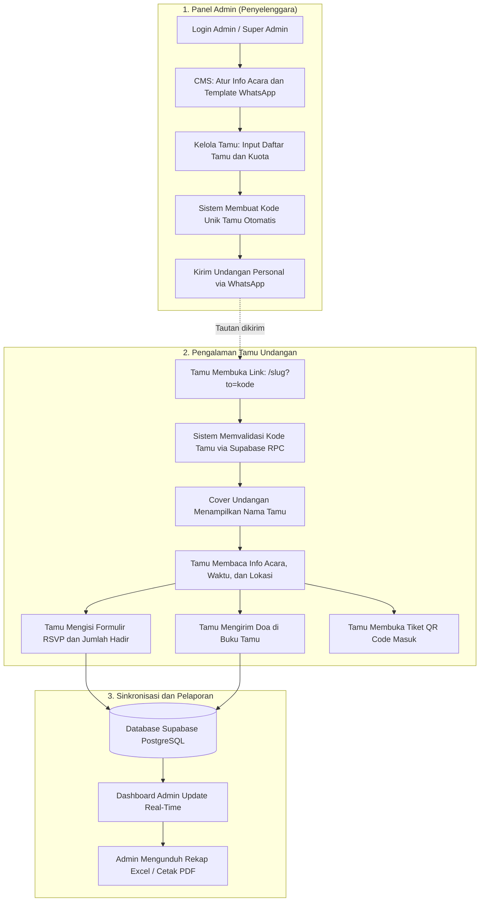
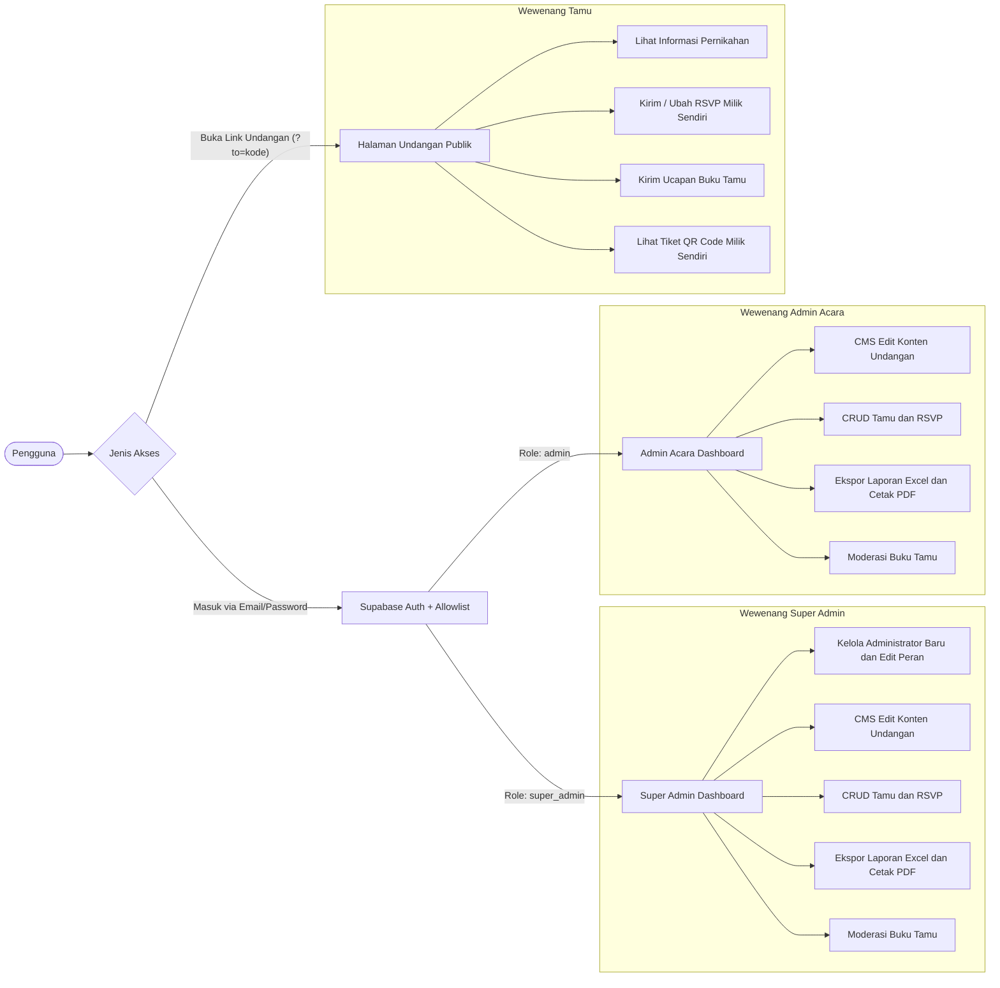
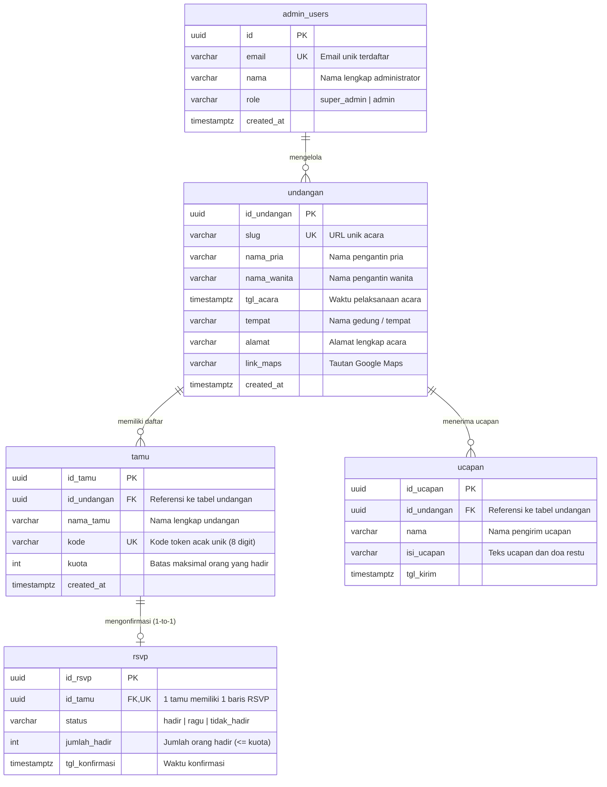

# WeddingMu — Digital Wedding Invitation Platform

<div align="center">


Platform Undangan Pernikahan Digital Interaktif dengan Sistem Konfirmasi Kehadiran (RSVP) Real-Time, Buku Tamu Digital, Manajemen Tamu Multi-Role, Tiket QR Code, dan Ekspor Laporan Kehadiran.

*Dokumentasi Proyek Uji Kompetensi Keahlian (UKK) Rekayasa Perangkat Lunak.*

[Demo Akun](#akun-demo-dan-hak-akses) • [Fitur Utama](#fitur-utama) • [Alur Sistem](#alur-sistem-dan-arsitektur) • [Struktur ERD](#entity-relationship-diagram-erd) • [Panduan Instalasi](#panduan-instalasi-dan-penggunaan)

</div>

---

## Daftar Isi
1. [Deskripsi Proyek](#deskripsi-proyek)
2. [Tangkapan Layar](#tangkapan-layar)
3. [Fitur Utama](#fitur-utama)
4. [Alur Sistem dan Arsitektur](#alur-sistem-dan-arsitektur)
5. [Entity Relationship Diagram (ERD)](#entity-relationship-diagram-erd)
6. [Struktur dan Kamus Data](#struktur-dan-kamus-data)
7. [Akun Demo dan Hak Akses](#akun-demo-dan-hak-akses)
8. [Panduan Instalasi dan Penggunaan](#panduan-instalasi-dan-penggunaan)
9. [Keamanan Sistem](#keamanan-sistem)
10. [Pemenuhan Ketentuan Rubrik UKK](#pemenuhan-ketentuan-rubrik-ukk)
11. [Tech Stack](#tech-stack)
12. [Lisensi](#lisensi)

---

## Deskripsi Proyek

**WeddingMu** adalah aplikasi berbasis web yang mentransformasikan undangan pernikahan cetak menjadi media digital yang personal, interaktif, dan efisien. Aplikasi ini dibangun untuk mempermudah calon pengantin serta panitia dalam menyebarkan informasi acara dan merekap kepastian kehadiran tamu secara terstruktur.

### Masalah yang Diselesaikan:
- **Biaya dan Waktu Cetak:** Pengadaan undangan cetak memerlukan biaya produksi tinggi dan proses distribusi manual yang lambat.
- **Ketidakpastian Jumlah Kehadiran:** Tuan rumah kesulitan memperkirakan jumlah tamu hadir secara akurat untuk kebutuhan katering dan kapasitas ruangan.
- **Buku Tamu Manual:** Buku tamu kertas rawan hilang, rusak, dan menyulitkan pengarsipan ucapan selamat dari para tamu.
- **Distribusi Pesan:** Penyebaran link secara manual sering kali tidak menyapa nama tamu secara personal.

### Solusi yang Diberikan:
- **Tautan Personal Dinamis (`?to=kode`):** Menampilkan nama tamu secara otomatis pada cover undangan saat tautan dibuka.
- **Konfirmasi RSVP Tervalidasi:** Tamu mengonfirmasi kehadiran (Hadir, Ragu-ragu, Tidak Hadir) dengan validasi kuota maksimal orang.
- **Buku Tamu Digital:** Ucapan doa restu ditampilkan langsung dengan animasi running text yang tersinkronisasi secara real-time.
- **Tiket QR Code Masuk:** Setiap tamu memiliki tiket QR digital untuk verifikasi saat hadir di lokasi resepsi.
- **Dashboard Multi-Role:** Mempelai dan administrator dapat memantau statistik kehadiran, mengelola data tamu, mengedit detail acara via CMS, serta mengunduh laporan dalam format Excel (CSV) maupun cetak PDF.
- **Desain Neobrutalism dan Rule of Eights:** Antarmuka responsif dengan grid 8pt yang teruji rapi dan bebas overflow di layar ponsel (360px–390px).

---

## Tangkapan Layar

### 1. Tampilan Publik Undangan Digital (Mobile View)
Cover interaktif yang menampilkan nama tamu terundang, tombol buka undangan, dan elemen visual Neobrutalism.
<div align="center">
  
</div>

### 2. Panel Admin Dashboard dan Rekapitulasi RSVP
Statistik kehadiran real-time, ringkasan porsi katering, filter pencarian tamu, dan alat ekspor laporan.
<div align="center">
  
</div>

### 3. Tampilan Responsif Smartphone
Tata letak yang dirancang menggunakan grid 8pt memastikan seluruh tombol aksi dan navigasi tetap berada di dalam batas layar.
<div align="center">
  
</div>

---

## Fitur Utama

### Sisi Tamu Undangan (Guest / Publik):
- **Cover Interaktif:** Halaman pembuka personal dengan nama tamu yang dimuat dari parameter URL.
- **Informasi Mempelai:** Profil kedua calon pengantin beserta kutipan dan informasi keluarga.
- **Jadwal dan Countdown:** Penghitung waktu mundur menuju hari-H pelaksanaan akad dan resepsi.
- **Integrasi Google Maps:** Tautan navigasi satu klik menuju titik lokasi acara.
- **Galeri Foto:** Galeri dokumentasi pra-nikah dengan tampilan kartu Neobrutalist.
- **Konfirmasi RSVP:** Formulir kehadiran dengan pilihan status dan validasi jumlah orang sesuai kuota.
- **Buku Tamu:** Formulir kirim ucapan selamat dan daftar doa restu dengan tampilan marquee.
- **Kado Digital:** Informasi nomor rekening bank (fitur salin rekening otomatis) dan alamat pengiriman kado fisik.
- **Tiket QR Code Digital:** Pratinjau tiket masuk personal berbasis QR code.

### Sisi Administrator (Dashboard Pengelola):
- **Autentikasi Multi-Role:** Hak akses terpisah untuk **Super Admin** dan **Admin Acara**.
- **Ringkasan Statistik RSVP:** Metrik total tamu, jumlah hadir, ragu-ragu, absen, belum merespon, serta estimasi total porsi katering.
- **CRUD Tamu Undangan:** Tambah tamu, ubah kuota, hapus tamu, generate link personal, salin link, dan tombol kirim WhatsApp otomatis.
- **Pencarian dan Filter:** Pencarian berdasarkan nama tamu atau kode unik, disertai filter status kehadiran.
- **Paginasi Data:** Penomoran halaman fleksibel (20, 50, atau 100 data per halaman) dengan navigasi angka dan ellipsis.
- **Laporan Excel dan Cetak PDF:**
  - Ekspor seluruh data kehadiran tamu ke berkas `.csv` (kompatibel Excel dengan UTF-8 BOM).
  - Cetak laporan rekapitulasi kehadiran langsung ke printer atau simpan sebagai PDF.
- **CMS Konten Undangan:** Pengaturan nama mempelai, jadwal acara, alamat gedung, tautan Google Maps, slug URL, dan template pesan WhatsApp tanpa modifikasi kode sumber.
- **Manajemen Administrator (Super Admin):** Mendaftarkan akun admin baru, mengubah peran admin, serta mengelola akses pengguna.

---

## Alur Sistem dan Arsitektur

### 1. Diagram Alur Kerja (Workflow Diagram)



### 2. Diagram Hak Akses Multi-Role



---

## Entity Relationship Diagram (ERD)

Arsitektur basis data relasional PostgreSQL pada Supabase menggunakan integritas referensial dan kaskade penghapusan data (`ON DELETE CASCADE`):



---

## Struktur dan Kamus Data

### 1. Tabel `public.undangan`
Menyimpan konfigurasi informasi utama acara pernikahan.
| Nama Kolom | Tipe Data | Batasan (Constraint) | Deskripsi |
|---|---|---|---|
| `id_undangan` | `uuid` | Primary Key, `gen_random_uuid()` | Pengidentifikasi unik acara |
| `slug` | `varchar(60)` | Unique, Not Null | URL ramah pencari (contoh: `arya-dan-sekar`) |
| `nama_pria` | `varchar(60)` | Not Null | Nama lengkap mempelai pria |
| `nama_wanita` | `varchar(60)` | Not Null | Nama lengkap mempelai wanita |
| `tgl_acara` | `timestamptz` | Nullable | Tanggal dan jam pelaksanaan acara |
| `tempat` | `varchar(100)` | Nullable | Nama gedung / aula / lokasi |
| `alamat` | `text` | Nullable | Alamat lengkap lokasi acara |
| `link_maps` | `text` | Nullable | Tautan URL titik Google Maps |
| `created_at` | `timestamptz` | Default `now()` | Waktu pencatatan data |

### 2. Tabel `public.tamu`
Menyimpan data tamu yang diundang oleh panitia.
| Nama Kolom | Tipe Data | Batasan (Constraint) | Deskripsi |
|---|---|---|---|
| `id_tamu` | `uuid` | Primary Key, `gen_random_uuid()` | Pengidentifikasi unik tamu |
| `id_undangan` | `uuid` | Foreign Key `undangan(id_undangan)` | ID acara terkait (Cascade Delete) |
| `nama_tamu` | `varchar(100)` | Not Null | Nama tamu yang dicantumkan pada undangan |
| `kode` | `varchar(20)` | Unique, Not Null | Token kode unik 8-digit untuk link personal |
| `kuota` | `integer` | Default `1`, Check `kuota >= 1` | Batas maksimal orang yang boleh hadir |
| `created_at` | `timestamptz` | Default `now()` | Waktu penambahan tamu |

### 3. Tabel `public.rsvp`
Menyimpan konfirmasi kehadiran dari tamu undangan.
| Nama Kolom | Tipe Data | Batasan (Constraint) | Deskripsi |
|---|---|---|---|
| `id_rsvp` | `uuid` | Primary Key, `gen_random_uuid()` | Pengidentifikasi unik data RSVP |
| `id_tamu` | `uuid` | Foreign Key `tamu(id_tamu)`, Unique | ID tamu yang mengisi (1-to-1) |
| `status` | `varchar(15)` | Check `status IN ('hadir', 'ragu', 'tidak_hadir')` | Pilihan konfirmasi kehadiran |
| `jumlah_hadir` | `integer` | Check `jumlah_hadir >= 0` | Jumlah tamu yang hadir secara fisik |
| `tgl_konfirmasi` | `timestamptz` | Default `now()` | Waktu saat tamu menyimpan konfirmasi |

### 4. Tabel `public.ucapan`
Menyimpan doa dan ucapan selamat dari para tamu untuk buku tamu digital.
| Nama Kolom | Tipe Data | Batasan (Constraint) | Deskripsi |
|---|---|---|---|
| `id_ucapan` | `uuid` | Primary Key, `gen_random_uuid()` | Pengidentifikasi unik ucapan |
| `id_undangan` | `uuid` | Foreign Key `undangan(id_undangan)` | ID acara yang menerima ucapan |
| `nama` | `varchar(100)` | Not Null | Nama pengirim ucapan |
| `isi_ucapan` | `text` | Not Null, Max 500 karakter | Isi pesan doa restu |
| `tgl_kirim` | `timestamptz` | Default `now()` | Waktu pengiriman ucapan |

### 5. Tabel `public.admin_users`
Menyimpan daftar administrator terdaftar beserta hak peran (*role-based access control*).
| Nama Kolom | Tipe Data | Batasan (Constraint) | Deskripsi |
|---|---|---|---|
| `id` | `uuid` | Primary Key, `gen_random_uuid()` | ID pengguna admin |
| `email` | `text` | Unique, Not Null, Lowercase | Alamat email administrator |
| `nama` | `text` | Not Null | Nama lengkap administrator |
| `role` | `text` | Check `role IN ('super_admin', 'admin')` | Tingkat hak akses administrator |
| `created_at` | `timestamptz` | Default `now()` | Waktu pendaftaran akun |

---

## Akun Demo dan Hak Akses

Disediakan akun demo untuk pengujian sistem oleh tim penguji UKK atau evaluator:

| Peran (Role) | Email Login | Password / Akses | Hak Akses Utama |
|---|---|---|---|
| **Super Admin** | `developer@admin.id` | Masuk via Panel Admin (atau aktivasi password baru) | Akses Penuh: Kelola Admin, CMS Acara, Tamu, RSVP, Ekspor Excel/PDF, Buku Tamu |
| **Admin Acara** | `mempelai@admin.id` | Masuk via Panel Admin | Akses Acara: CMS Acara, Kelola Tamu, RSVP, Ekspor Excel/PDF, Buku Tamu |
| **Tamu Undangan (Demo 1)** | Tanpa Login | [Buka Undangan Tamu 1](http://localhost:3000/?to=88231920) (Kode: `88231920`) | Atas nama **Bapak Ahmad Subagyo** (Kuota: 2 orang) |
| **Tamu Undangan (Demo 2)** | Tanpa Login | [Buka Undangan Tamu 2](http://localhost:3000/?to=77419204) (Kode: `77419204`) | Atas nama **Ibu Siti Rahmawati** (Kuota: 1 orang) |

*Catatan Login:*
- Jika akun belum memiliki password di Supabase Auth, buat password melalui form **"Aktivasi Akun Admin"** pada halaman `/admin`.
- Sistem mencocokkan email dengan daftar allowlist pada tabel `admin_users`.

---

## Panduan Instalasi dan Penggunaan

### 1. Prasyarat Sistem
- **Node.js:** Versi `18.18.0` atau yang lebih baru (disarankan Node.js 20 LTS).
- **Package Manager:** `npm`, `pnpm`, atau `yarn`.
- **Git:** Terpasang di sistem operasi Anda.
- **Akun Supabase:** Proyek Supabase gratis untuk database PostgreSQL.

### 2. Kloning Repository
Buka terminal dan unduh kode sumber proyek:
```bash
git clone https://github.com/username/digital_invitation.git
cd digital_invitation
```

### 3. Instalasi Dependensi
Jalankan perintah instalasi paket:
```bash
npm install
```

### 4. Konfigurasi Environment Variables
Salin berkas template `.env.example` menjadi `.env.local`:
```bash
cp .env.example .env.local
```
Buka file `.env.local` dan isi kredensial Supabase Anda:
```env
NEXT_PUBLIC_SUPABASE_URL=https://your-project-id.supabase.co
NEXT_PUBLIC_SUPABASE_ANON_KEY=your-supabase-anon-public-key
```

### 5. Setup Database di Supabase
1. Masuk ke [Supabase Dashboard](https://supabase.com/dashboard).
2. Buka menu **SQL Editor**.
3. Eksekusi skrip pertama: buka file [`supabase_admin_roles.sql`](supabase_admin_roles.sql), salin ke SQL Editor, lalu jalankan (**Run**).
4. Eksekusi skrip kedua: buka file [`supabase_fix_rls.sql`](supabase_fix_rls.sql), salin ke SQL Editor, lalu jalankan (**Run**).
5. Database dan fungsi keamanan (RLS dan Stored Procedures) telah aktif.

### 6. Menjalankan Server Pengembangan
Jalankan aplikasi secara lokal:
```bash
npm run dev
```
Akses aplikasi melalui browser:
- Halaman Undangan Publik: [http://localhost:3000](http://localhost:3000)
- Halaman Panel Admin: [http://localhost:3000/admin](http://localhost:3000/admin)

### 7. Uji Kualitas Kode dan Build Produksi
Sebelum deploy, pastikan tidak ada kesalahan linter atau error build:
```bash
# Pemeriksaan Linter ESLint (0 errors, 0 warnings)
npm run lint

# Kompilasi Build Next.js Produksi
npm run build

# Menjalankan Server Hasil Build
npm run start
```

---

## Keamanan Sistem

1. **Prepared Statements dan Parameterized Queries:** Interaksi basis data melalui Supabase Client SDK (PostgREST) menggunakan parameterized queries sehingga terlindungi dari celah SQL Injection.
2. **Row Level Security (RLS) PostgreSQL:**
   - Tabel `tamu` dan `rsvp` dilindungi RLS sehingga pengguna publik (`anon`) tidak dapat membaca keseluruhan data tamu maupun mengubah data milik tamu lain.
   - Akses data tamu publik dilakukan melalui fungsi tersimpan `public.get_guest_by_code(p_kode)` dan `public.submit_guest_rsvp(...)`.
3. **Penyimpanan Password Terenkripsi:** Password administrator dikelola oleh Supabase Auth yang menggunakan hashing **bcrypt** tersertifikasi.
4. **Validasi Input dan Sanitasi:**
   - Validasi batas kuota di sisi klien dan database (kuota minimal 1 orang, jumlah hadir tidak boleh melebihi kuota).
   - React JSX secara otomatis melakukan sanitasi karakter berbahaya untuk menangkal serangan Cross-Site Scripting (XSS).
5. **Fungsi Security Definer Terisolasi:** Prosedur RPC verifikasi hak akses admin menggunakan `SECURITY DEFINER` dengan skema terisolasi untuk menghindari celah rekursi RLS.

---

## Pemenuhan Ketentuan Rubrik UKK

| No | Ketentuan Rubrik UKK | Status | Implementasi pada Proyek WeddingMu |
|:---:|---|:---:|---|
| 1 | **Autentikasi dan Multi-Role** (Minimal 2 Peran) | Lengkap | Dua peran aktif: **Super Admin** (kelola tim admin dan sistem) dan **Admin Acara** (kelola tamu dan acara). Tamu mengakses undangan dengan token kode unik. |
| 2 | **Operasi CRUD Lengkap** | Lengkap | - **Create:** Tambah tamu baru, kirim ucapan, registrasi admin baru.<br>- **Read:** Tabel tamu berpaginasi, statistik RSVP, guestbook marquee.<br>- **Update:** Edit acara via CMS, ubah peran admin, perbarui konfirmasi RSVP.<br>- **Delete:** Hapus data tamu (cascade ke RSVP), hapus admin, hapus ucapan. |
| 3 | **Pencarian Data (Search)** | Lengkap | Pencarian instan pada tabel tamu berdasarkan nama tamu atau kode unik 8 digit. |
| 4 | **Filter Status** | Lengkap | Dropdown filter status kehadiran: *Semua Tamu*, *Konfirmasi Hadir*, *Masih Ragu*, *Tidak Hadir*, dan *Belum Konfirmasi*. |
| 5 | **Pagination (Penomoran Halaman)** | Lengkap | Paginasi interaktif dengan pilihan 20, 50, atau 100 data per halaman, tombol Sebelumnya/Selanjutnya, dan nomor halaman ber-ellipsis. |
| 6 | **Laporan yang Dapat Dicetak / Diekspor** | Lengkap | - **Export Excel (CSV):** Mengunduh data lengkap rekap kehadiran tamu dalam format CSV (UTF-8 BOM).<br>- **Cetak Laporan / PDF:** Tombol Cetak/PDF langsung membuka dialog print browser dengan format dokumen rapi. |
| 7 | **Keamanan Dasar** | Lengkap | Password ter-hash aman (bcrypt), prepared statements anti-SQLi, validasi batas kuota kehadiran, proteksi RLS PostgreSQL, dan sanitasi XSS. |
| 8 | **Tampilan Responsif (Mobile-Friendly)** | Lengkap | Dirancang dengan aturan **Rule of Eights (Grid 8pt)**, bebas overflow horizontal pada layar smartphone (360px–390px), serta drawer navigasi yang ergonomis. |
| 9 | **Dokumentasi Lengkap (README dan ERD)** | Lengkap | Dokumentasi mencakup deskripsi proyek, tangkapan layar, alur sistem, ERD Mermaid, kamus data, akun demo, dan panduan instalasi. |

---

## Tech Stack

- **Core Framework:** [Next.js](https://nextjs.org/) 16 (App Router) dengan Turbopack
- **Bahasa Pemrograman:** [TypeScript](https://www.typescriptlang.org/)
- **Styling:** [Tailwind CSS](https://tailwindcss.com/) (Gaya Semi-Neobrutalism dan Rule of Eights)
- **Database dan Auth:** [Supabase](https://supabase.com/) (PostgreSQL dengan Row Level Security)
- **Animasi dan Interaksi:**
  - [Lenis](https://lenis.darkroom.engineering/) — Smooth momentum scrolling
  - [Canvas Confetti](https://www.npmjs.com/package/canvas-confetti) — Animasi konfirmasi RSVP
- **Tipografi:** Google Fonts (Plus Jakarta Sans, Clash Display)

---

## Lisensi

Proyek ini dilisensikan di bawah **MIT License**. Bebas digunakan, dimodifikasi, dan dikembangkan untuk keperluan akademik, edukasi, maupun implementasi profesional.
